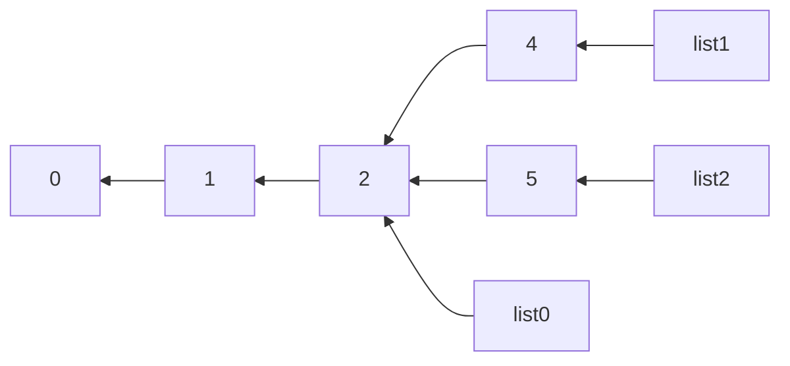

# Functional data structures

---
transition: fade
---

## Higher-Order Functions (HOFs)

HOFs are functions taking/returning functions and are at the core of functional programming.

```scala {1|3-5|3-9}
List(1, 2, 3).map(x => x + 1)

def scoreComputer(xs: List[Element]): Element => Double =
  val best = xs.head
  (e: Element) => e.score / best.score

val elements: List[Element]         = List(Element(8), Element(4), Element(2))
val scores: List[Double]            = elements.map(scoreComputer(elements))
// scores: List[Double] = List(1.0, 0.5, 0.25)
```

<v-after>

HOFs allow to:

</v-after>

<v-clicks>

- **Decompose** complex problems into simpler ones
- **Reuse** code easily
- **Abstract** over data structures: we can write extremely generic methods

</v-clicks>

---
transition: fade
---

## Functional Data Structures

When combining immutability and HOFs, we can create very rich functional data structures:

<v-clicks>

- Reusable collections with smart operations (foldLeft, filter, take, etc.)
- Infinite data structures (streams, lazy lists)
- Properties based structures (sets, etc.)

</v-clicks>

---
transition: fade
---

### Reusable collections

Immutability gives us the guarantee that the data will not change at any time. So we can safely reuse the same collection to build other collections

<TwoColumns>

<template v-slot:col1 style="width: 50%">



</template>

<template v-click v-slot:col2 style="width: 50%">

W/O immutability, to keep the safety we need to copy the whole collection each time we operate on it

</template>

</TwoColumns>

<v-click>

In the case of a collection, what is required to ensure that it didn't change in the meantime?

</v-click>

<v-click>

- Immutable data structure: the collection is never modified
- AND immutable objects: the objects contained are never modified

</v-click>

---
transition: fade
---

### Infinite data structures

Create an infinite list (lazy list) from the following trait and a generator function

```scala
sealed trait InfiniteList[A]:
  def head: A
  def tail: InfiniteList[A]

  def map[B](f: A => B): InfiniteList[B]
  def flatMap[B](f: A => InfiniteList[B]): InfiniteList[B]
  def filter(p: A => Boolean): InfiniteList[A]

  def take(n: Int): InfiniteList[A]
  def toList: List[A] = ???

object InfiniteList:
  def from[A]/*parameters and implementation...*/
```

---
transition: fade
---

### Properties Based Structures & Infinite Sets

We usually represent a `Set` with concrete elements, but we can also represent it with properties

```scala
class PBSet[T](property: T => Boolean):
  def contains(e: T): Boolean
  def union(other: PBSet[T]): PBSet[T]
  def intersect(other: PBSet[T]): PBSet[T]
  // ...
```

---
transition: fade
---

## Working with Lists

As most sequence in Scala, `List` has a lot of methods to manipulate it:

```scala {1|1,3|1,4-7|1,8,9|1,10|1,11|1,12-15}
val list = List(1, 2, 3, 4)

list.filter(x => x % 2 == 0)          // List(2, 4)
list.map(x => x + 1)                  // List(2, 3, 4, 5)
list.map(x => List(x, x + 1))         // List(List(1, 2), List(2, 3), List(3, 4), List(4, 5))
list.flatMap(x => List(x, x + 1))     // List(1, 2, 2, 3, 3, 4, 4, 5)
list.zip(list)                        // List((1, 1), (2, 2), (3, 3), (4, 4))
list.take(2)                          // List(1, 2)
list.takeWhile(_ < 4)                 // List(1, 2, 3)
list.foldLeft(0)((acc, x) => acc + x) // 10
list.reduce(_ + _)                    // 10
list.collect:
  case x if x % 3 == 0 => x
  case x if x % 2 == 0 => x + 1
// List(3, 3, 5)
```

---
transition: fade
---

## Special cases --- `map` / `flatMap` / `zip`

From before

```scala {1,2|3|4}
list.map(x => x + 1)                  // List(2, 3, 4, 5)
list.map(x => List(x, x + 1))         // List(List(1, 2), List(2, 3), List(3, 4), List(4, 5))
list.flatMap(x => List(x, x + 1))     // List(1, 2, 2, 3, 3, 4, 4, 5)
list.zip(list)                        // List((1, 1), (2, 2), (3, 3), (4, 4))
```

- <span>`map` transforms each element</span>
- <span v-click="1">`flatMap` transforms each element into an <u>iterable</u> and then reduce the dimension by 1</span>
- <span v-click="2">`zip` combines two lists element-wise and returns a list of pairs</span>

---
transition: fade
---

## Special cases --- `foldLeft` / `reduce`

From before

```scala
list.foldLeft(0)((acc, x) => acc + x) // 10
list.reduce(_ + _)                    // 10
```

<v-clicks>

- `reduce` allows to shrink a list to a single value
  - The returned value must be of the same type as the list's elements
  - The list <u>must not</u> be empty
- `foldLeft` is a more general `reduce` that takes an initial value
  - The list can be empty
  - The returned value can be of a different type than the list's elements
  - It may not only return a single value
- In both cases, the operation should be associative...

</v-clicks>

---
transition: fade
---

## Special cases --- `collect` and `PartialFunction`

From before

```scala
list.collect:
  case x if x % 3 == 0 => x
  case x if x % 2 == 0 => x + 1
  // where's my exhaustiveness ? what if x = 5 ?
```

<v-clicks depth="2">

- `collect` takes a `PartialFunction` and applies it to each element
  - A `PartialFunction` is a function that is not defined for all inputs
  - if the PF is not defined for an element, then it's filtered out
- it can act as both a filtering and a mapping operation

</v-clicks>

---
layout: section
transition: fade
---

## Exercices --- HOFs & Collections

---
transition: fade
---

### Exercices --- HOFs & Collections

Given:
```scala
case class User(name: String, age: Int, email: Option[String])
val users = List(User("Alice", 25, Some("alice@mail.com")), User("Bob", 17, None), User("Charlie", 30, Some("charlie@mail.com")))
```

1. 🟢 Get a list of all user names
2. 🟢 Filter users who are adults (age >= 18)
3. 🟡 Get all emails (only those defined) as a `List[String]`
4. 🟡 Compute the average age using `foldLeft`
5. 🔴 Using `collect`, get emails of adult users in one operation
6. 🔴 Group users by adult/minor status: `Map[String, List[User]]`

<v-click>

```scala
// Hint for 5: collect combines filter + map
users.collect { case ??? => ??? }
```

</v-click>

---
transition: fade
---

## Exercice --- Real World

You have the following setup:

```scala
case class Product(id: Int)
case class ProductSet(filters: Seq[String], products: Seq[Product])
def fetchProductSetFromFilter(filter: String): Set[Product]
```

<v-click>

And someone asked you to retrieve $n$ products from a list of filters. To reduce the DB workload, if there are remaining filters to check when $n$ products are reached, you won't call the DB.

````md magic-move

```scala {hide|all|all}
def fetchNProducts(n: Int, filters: Seq[String]): Set[Product] = ???
```

```scala
def fetchNProducts(n: Int, filters: Seq[String]): Set[Product] = ???
// Logic for one filter
(fetchedProducts, currentFilter) match
  case (ps, _) if ps.size >= n => ps
  case (ps, filter) =>
    ps ++ fetchProductSetFromFilter(filter).take(n - ps.size)

```

```scala {all|all}
def fetchNProducts(n: Int, filters: Seq[String]): Set[Product] =
  filters.foldLeft(Set.empty) {
    case (ps, _) if ps.size >= n => ps
    case (ps, filter) =>
      ps ++ fetchProductSetFromFilter(filter).take(n - ps.size)
  }
```

```scala
// tail recursion !
def fetchNProducts(n: Int, filters: List[String]): Set[Product] =
  def loop(ps: Set[Product], filters: List[String]): Set[Product] =
    if (ps.size >= n || filters.isEmpty) ps
    else loop(ps ++ fetchProductSetFromFilter(filters.head).take(n - ps.size), filters.tail)
  loop(Set.empty, filters)
```

````

</v-click>

<v-click at="3">

How would you implement this function in a functional way? (no mutation, no `var`, no `while`)

</v-click>

<v-click at="6">

Problem: the `foldLeft` will iterate over all the filters, even if we already have $n$ products. Solution ?

</v-click>

<!--
Why a List[String] and not a Seq[String] for the filters in the loop method ?
-->
