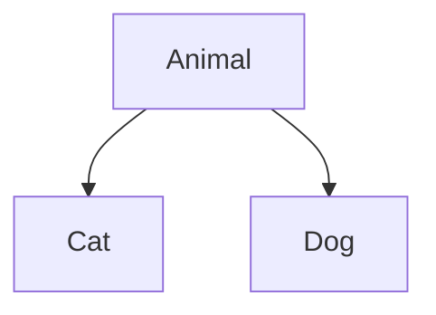
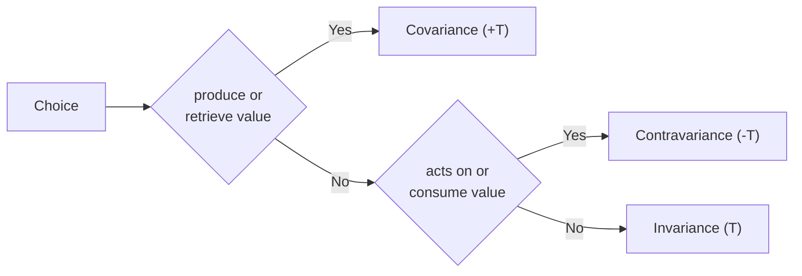

# Scala

---
transition: fade
---

## General

- Created in 2001, v1 in 2004
- First language to mix OOP and FP
- Statically and very strongly typed
- Has a strong type inference
- Immutable by default, yet allows mutation
- Concise syntax
- Is not just a better Java ^^

---
transition: fade
---

## From Rust to Scala --- What's Familiar 1

You already know many FP concepts from Rust!

| Rust | Scala | Notes |
|------|-------|-------|
| `Option<T>` | `Option[T]` | `Some`/`None` --- nearly identical |
| `Result<T, E>` | `Either[E, T]` | Same concept, swapped params |
| `vec.iter().map(\|x\| x + 1)` | `list.map(_ + 1)` | HOFs everywhere |
| `vec.iter().filter(\|x\| *x > 0)` | `list.filter(_ > 0)` | Same pattern |
| `match value { ... }` | `value match { ... }` | Pattern matching! |

---
transition: fade
---

## From Rust to Scala --- What's Familiar 2

You already know many FP concepts from Rust!

| Rust | Scala | Notes |
|------|-------|-------|
| `enum Color { Red, Blue }` | `enum Color { case Red, Blue }` | ADTs |
| `impl Trait for Type` | `given Trait[Type] with ...` | Type classes |
| `fn foo<T: Display>(x: T)` | `def foo[T: Show](x: T)` | Trait bounds |
| `?` operator | `for-yield` / `flatMap` | Error propagation |

<v-click>

**Key differences**: No ownership/lifetimes in Scala, runs on JVM, has `null` (but we avoid it)

</v-click>

---
transition: fade
---

## Quick syntax

- `val` for immutable variables, `var` for mutable ones
- `def` for functions
  - you can use any character for the function name (e.g. `+`, `++`, `::`, `^`, `?`, `!`, ...)
- `if ... then ... else ...` is an expression
- `def name = ...` is a 0-arg method and mustn't be called with parenthesis
- a public `val`/`var` can override a `def` (but not the opposite)
  - not really syntax, but good to know as I'll use it later

```scala
list.map { x => x match
  case x => ...
  case y => ...
  case _ => ...
}
// same as
list.map {
  case x => ...
  case y => ...
  case _ => ...
}
```

---
transition: fade
---

## Functions in Scala

In Scala, a function is an instance of `FunctionN` trait, with $N$ being the number of arguments

```scala {1-3|4|6-9}
val f1: Function1[Int, Int] = new Function1[Int, Int] {
  def apply(x: Int): Int = x + 1
}
val f1_short: Int => Int = (x: Int) => x + 1 // shorthand notation

val f2: Function2[Int, Int, Int] = new Function2[Int, Int, Int] {
  def apply(x: Int, y: Int): Int = x + y
}
val f2_short: (Int, Int) => Int = (x, y) => x + y
```

<v-click>

There's an even more concise way to define functions

</v-click>

```scala {hide|1-3|all}
val f1      : Int => Int = x => x + 1
val f1_short: Int => Int = _ + 1      // same

List(1, 2, 3).reduce((x, y) => x + y) // 6
List(1, 2, 3).reduce(_ + _)           // 6
```

<v-after>

`_` is a placeholder, with the n-th `_` being the n-th argument. It can be used only <u>once</u> per argument.

</v-after>

---
transition: fade
---

## Classes in Scala --- Simple class

In Scala a `class`:

- Takes one or more parameters clause(s): the constructor arguments
- Constructor arguments are private and immutable by default
- Body can only have instance methods / fields

```scala {1-3|5}
class Person(name: String, birthday: Date): // <- constructor parameters
  val someField: A  // <- some other field
  def age: Int      // <- instance method

class Person2(fName: String, lName: String, age: Int)(fullName: String = s"$fName $lName")
```

---
transition: fade
---

## Classes in Scala --- Singleton & companion

In Scala an `object` can be:

<v-clicks>

- Either a singleton class (a class instantiated only once)
- Or a companion of another class (it must then be in the same file as the class)
  - A companion defines constructor overloads and static members of the class
- Or a pattern extractor (see later)

</v-clicks>

```scala {hide|3-6}
class Person(name: String, birthday: Date)

object Person:
  val initialTimestamp // <- static field of class Person
  def apply(fName: String, lName: String, birth: LocalDate) // <- constructor overload
  def maskBirthdays(ps: Seq[Person]) // <- static method of class Person
```

---
transition: fade
---

## Classes in Scala --- Case classes

A `case class` is a `class` with some utilities already written for us:

<v-clicks>

- getters
- `equals` and `hashCode` methods
- `unapply` for pattern matching
- `toString`

</v-clicks>

```scala {hide|1-2|1-5|1-2,7-8|1-2,10-11|all}
class Person1(name: String, age: Int)
case class Person2(name: String, age: Int)

val p1 = Person1("Rabbit", 23) // Person1@2848284
val p2 = Person2("Rabbit", 23) // Person2(Rabbit, 23)

p1 == Person1("Rabbit", 23) // false
p2 == Person2("Rabbit", 23) // true

p1.name // Compile error!
p2.name // "Rabbit"
```

---
transition: fade
---

## Classes in Scala --- Traits

A `trait` is like an `interface` but with superpowers:

<v-clicks>

- Can have non static fields and methods
- Can have implementations
- A class can extend multiple traits

</v-clicks>

```scala {hide|1-4|6-8}
trait MakeNoise:
  def makeNoise: String
trait Animal:
  def name: String

case class Dog(name: String) extends Animal with MakeNoise:
  def makeNoise = "Woof"
```

<v-click>

Avoid using `val`s in traits, as they might be called before instantiation (thus returning an unexpected `null` value)

</v-click>

---
transition: fade
---

## Classes in Scala --- sealed

A `sealed` class/trait can only be extended in the same file:

<v-clicks>

- Useful for pattern matching exhaustiveness (compiler warning)
- Useful for ADTs (Algebraic Data Types)
- Make sure your code won't be extended in a way you didn't expect
- Make sure your code will always be exhaustive when you're extending it

</v-clicks>

```scala {hide|1-3|5-8}
sealed trait Animal
case class Dog() extends Animal
case class Cat() extends Animal

val a: Animal = ???
a match
  case Dog() => "A dog"
  case Cat() => "A cat"
```

<v-click>

Now try adding another `case class` extending `Animal` and see what happens 🙂

</v-click>

---
transition: fade
---

## Pattern matching in Scala

Patterns can be made of: literals / variables<span v-click="2"> or extractors</span>

````md magic-move

```scala
val specialNegative = -42
-42 match
  case 0                  => "Not positive nor negative"  // literal
```

```scala
val specialNegative = -42
-42 match
  case 0                  => "Not positive nor negative"  // literal
  case x if x > 0         => "Positive"                   // bind new variable with guarded pattern
  case `specialNegative`  => "Minus number of life"       // bind on existing variable
  case _                  => "Negative"                   // the rest
```

```scala
case class Person(name: String, age: Int, favLang: String)
person match
  case Person("Lucas", age, _) if age < 18  => "Hello mini Lucas" // extractor
  case _                                    => "Hello stranger"
```

```scala {3|all}
case class Person(name: String, age: Int, favLang: String)
person match
  case Person(_, _, "Scala" | "Rust") => "Charming person" // another extractor
  case _                              => "Hello stranger"
```

````

<v-after>

❗ The order of the cases matters as it doesn't waterfall. The first match returns from the `match` ❗

</v-after>

```scala {hide|all}
42 match
  case x                => s"Hi $x!"
  case x if x % 2 == 0  => s"Hi $x! You're even" // unreachable case
```

<span v-after>The compiler will issue a warning in such cases 🙂</span>

<!-- être moins rapide, passer plus de temps sur les extracteurs généraux (Option vs Boolean) -->

---
layout: section
transition: fade
---

## Exercices --- Scala OOP

---
transition: fade
---

### Exercices --- Scala OOP

1. 🟢 Define a `Person` (defined with a name and an age) with 2 constructor methods `newborn(name: String)` defaulting age to `0`, and `adult(name: String)` creating a 18-year-old
2. 🟡 Model a `Result` type as a sealed trait with `Success(value: Int)` and `Error(message: String)`. Write `describe(r: Result): String` that pattern matches on both cases. What happens if you add a new case?
3. 🔴 Create a mini expression evaluator: sealed trait `Expr` with cases `Num(n: Int)`, `Add(a: Expr, b: Expr)`, `Mul(a: Expr, b: Expr)`. Write `eval(e: Expr): Int` using pattern matching

<v-click>

```scala
// Expected behavior for exercice 3
val expr = Add(Num(2), Mul(Num(3), Num(4))) // 2 + (3 * 4)
eval(expr) // 14
```

</v-click>

---
transition: fade
---

### Boolean Extractors

A boolean extractor is an `unapply` method returning a `Boolean` contained in an `object`:

````md magic-move

```scala
42 match
  // Might not easily reflect the goal
  case x if x % 2 == 0 || (x > -10 && x < 10) => "You're special 🥰"
  case _                                      => "You're not special 😢"
```

```scala {1-2|1-4|all}
object IsEven:
  def unapply(x: Int): Boolean = x % 2 == 0
object IsSingleDigit:
  def unapply(x: Int): Boolean = x > -10 && x < 10

42 match
  case x @ (IsEven() | IsSingleDigit()) => s"You're special $x 🥰"
  case _                                => "You're not special 😢"
```

````

---
transition: fade
---

### General Extractors

As for boolean extractors, an extractor is an `unapply` method in an object, but it returns an `Option` (or any other value with `isEmpty` and `get` methods)

````md magic-move

```scala
case class Vehicle(name: String, isEcological: Boolean)

val person = Person("John", 25, vehicle = None)
person match           🤮🤮 v---------------------------v 🤮🤮
  case Person(_, _, v) if v.isEmpty || v.exists(_.isEcologic) => s"You're ecological with a ${v.get} 🤗"
  case _                                                      => "You're not ecological 😡"
```

```scala {3-7|9-12|all}
case class Vehicle(name: String, isEcological: Boolean)

object EcologicalVehicle:
  def unapply(v: Option[Vehicle]): Option[String] = v match
    case Some(Vehicle(name, true)) => Some(name)
    case None                      => Some("nothing")
    case _                         => None

val person = Person("John", 25, vehicle = None)
person match
  case Person(_, _, EcologicalVehicle(v/*: String*/)) => s"You're ecological with a $v 🤗"
  case Person(_, _, EcologicalVehicle("nothing"))     => "You're ecological without a vehicle 🤗"
  case _                                              => "You're not ecological 😡"
```

```scala {11-13}
case class Vehicle(name: String, isEcological: Boolean)

object EcologicalVehicle:
  def unapply(v: Option[Vehicle]): Option[String] = v match
    case Some(Vehicle(name, true)) => Some(name)
    case None                      => Some("nothing")
    case _                         => None

val person = Person("John", 25, vehicle = None)
person match
  case Person(_, _, EcologicalVehicle("nothing")) => "You're ecological without a vehicle 🤗"
  case Person(_, _, EcologicalVehicle(v))         => s"You're ecological with a $v 🤗"
  // the more general the case is, the later it should be
  case _                                          => "You're not ecological 😡"
```

````

<v-click at=3>

There's an error, can you spot it? 👀 <span v-after>✅</span>

</v-click>

---
layout: section
transition: fade
---

## Exercices --- Pattern Matching

---
transition: fade
---

### Exercices --- Pattern Matching

Using the following ADT:

```scala
sealed trait Json
case object JNull extends Json
case class JBool(value: Boolean) extends Json
case class JNum(value: Double) extends Json
case class JStr(value: String) extends Json
case class JArr(values: List[Json]) extends Json
case class JObj(fields: Map[String, Json]) extends Json
```

1. 🟢 Write `stringify(json: Json): String` that converts `JNull`, `JBool`, `JNum`, `JStr` to their string representation
2. 🟡 Extend `stringify` to handle `JArr` (hint: use `map` and `mkString`)
3. 🔴 Create a boolean extractor `IsPositive` for `JNum` and use it in a pattern match
4. 💀 Create an extractor `NestedArrays` on a `JArr` that matches if at least one element of the array is an array

---
transition: fade
---

## Variance in Scala

Variance describes the relationship between generic types: can a `List[Cat]` be used where a `List[Animal]` is expected?

```scala
sealed trait Animal
case class Cat() extends Animal

val animals: List[Animal] = List.empty[Cat]
```

<v-click>

Here is the Java's equivalent:

```zsh
jshell> List<Animal> animals = new ArrayList<Cat>();
|  Error:
|  incompatible types: java.util.ArrayList<Cat> cannot be converted to java.util.List<Animal>
|  List<Animal> animals = new ArrayList<Cat>();
|                         ^------------------^
```

Can you guess why it's not possible in Java, but is in Scala ?

</v-click>

```java {hide|1}
animals.set(0, new Dog()); // animals is not a List<Animal> but a List<Cat>, that's a type error
```

---
transition: fade
---

### Invariance

$T$: set of non-generic types (e.g. `Int`), $G$: set of generic types (e.g. `List`), $<:$ subtyping relation

<v-click>

The simplest form of variance. The type param must match exactly. It's Java's behavior and is the simplest to handle:

$$
\forall (F, (A, B)) \in (G, T^2) \quad A \neq B \Longleftrightarrow F[A] \neq F[B]
$$

</v-click>

<Anim spec="@code [1-3|4|5|6]">

```scala
val cats = List(Cat())
// catList: List[Cat] = List@1h2j343f
val cats2: List[Cat] = catList
// cats2: List[Cat] = List@1h2j343f
val animals: List[Animal] = catList
// Compile error!
```

</Anim>

<v-click>

Noted without any symbol

```scala
class List[T]
```

</v-click>

---
transition: fade
---

### Covariance

$T$: set of non-generic types (e.g. `Int`), $G$: set of generic types (e.g. `List`), $<:$ subtyping relation

<v-click>

The most intuitive form of variance. The type param can be a <u>sub</u>-type of the expected type (think of it as an extension of inheritance):

$$
\forall (F, (A, B)) \in (G, T^2) \quad A <: B \Longleftrightarrow F[A] <: F[B]
$$

</v-click>

<Anim spec="@code [1-3|4|5|6]">

```scala
val cats = new List(Cat())
// cats: List[Cat] = List@1h2j343f
val cats2: List[Cat] = catList
// cats2: List[Cat] = List@1h2j343f
val animals: List[Animal] = catList
// animals: List[Animal] = List@1h2j343f
```

</Anim>

<v-click>

Noted with a `+` symbol

```scala
class List[+T]
```

</v-click>

---
transition: fade
---

### Covariance (2)

Can you spot the weakness of covariance?

````md magic-move

```scala
trait List[+T]:
  def +:(elem: T): List[T] // prepend
```

```scala
trait List[+T] { def +:(elem: T): List[T] }

val cats: List[Cat] = List(Cat())
Dog() +: cats
// Doesn't compile because a Dog is not a Cat 👍
```

```scala
trait List[+T] { def +:(elem: T): List[T] }

val cats: List[Cat]       = List(Cat())
Dog() +: cats // Doesn't compile because a Dog is not a Cat 👍
val animals: List[Animal] = cats
Dog() +: animals
```

```scala
trait List[+T] { def +:(elem: T): List[T] }

val cats: List[Cat]       = List(Cat())
Dog() +: cats // Doesn't compile because a Dog is not a Cat 👍
val animals: List[Animal] = cats
Dog() +: animals // Could compile, even if we're saying that a Dog is a Cat 😱
// But the code doesn't compile because of this unsoundness 😮‍💨
```

```scala {2|2,5,7}
trait List[+T]:
  def +:[U >: T](elem: U): List[U] // prepend

val cats: List[Cat]       = List(Cat())
Dog() +: cats // res1: List[Animal] = List(Dog(), Cat())
val animals: List[Animal] = cats
Dog() +: animals // res2: List[Animal] = List(Dog(), Cat())
```

````

<v-click at="4">

It's annoying not to be able to consume an object when using covariance => we need to set a lower bound

</v-click>

<v-click at="5">



</v-click>

---
transition: fade
---

### Contravariance

$T$: set of non-generic types (e.g. `Int`), $G$: set of generic types (e.g. `List`), $<:$ subtyping relation

<v-click>

The most brainfucking form of variance. The type param can be a <u>super</u>-type of the expected type

$$
\forall (F, (A, B)) \in (G, T^2) \quad A <: B \Longleftrightarrow F[B] <: F[A]
$$

</v-click>

<v-click>

````md magic-move

```scala
trait Encoder[-T]: // Noted with a `-` symbol
  def encode(x: T): String

trait Person:
  def name: String

case class Chef(name: String, speciality: String) extends Person
```

```scala {5,7}
trait Encoder[-T] { def encode(x: T): String }
trait Person { def name: String }
case class Chef(name: String, speciality: String) extends Person

val chefEncoder = new Encoder[Chef]:
  def encode(chef: Chef): String = s"${chef.name} is a chef, specialized in ${chef.speciality}"
val personEncoder = new Encoder[Person]:
  def encode(person: Person): String = s"${person.name} is a person"
```

```scala
trait Encoder[-T] { def encode(x: T): String }
trait Person { def name: String }
case class Chef(name: String, speciality: String) extends Person

val chefEncoder = new Encoder[Chef] { def encode(chef: Chef): String = ??? }
val personEncoder = new Encoder[Person] { def encode(person: Person): String = ??? }

def enc[T <: Person](p: T)(encoder: Encoder[T]) = encoder.encode(p)

enc[Chef](Chef("John", "dessert"))(chefEncoder   /*: Encoder[Chef] */)
enc[Chef](Chef("John", "dessert"))(personEncoder /*: Encoder[Person] */)
```

````

</v-click>

---
transition: fade
---

### Summary



---
layout: section
transition: fade
---

## Exercices --- Variance

---
transition: fade
---

### Exercices --- Variance

```scala
sealed trait Animal
case class Dog(name: String) extends Animal
case class Cat(name: String) extends Animal
```

1. 🟢 Given `class Box[T](value: T)`, can you assign a `Box[Cat]` to a `Box[Animal]`? Why?
2. 🟡 Make `Box` covariant. What problem arises if you try to add `def set(v: T): Unit`?
3. 🟡 Define `trait Show[-A] { def show(a: A): String }`. Implement it for `Animal`. Can you use it to show a `Cat`? Why?
4. 🔴 Implement a covariant `List[+A]` with:
   - `push[B >: A](elem: B): List[B]`
   - `pop: (A, List[A])`
   - Why does `push` need the type bound `B >: A`?

    <v-click>

    ```scala
    // For exercise 4
    sealed trait List[+A]
    case object Empty extends List[Nothing]
    case class Cons[+A](head: A, tail: List[A]) extends List[A]
    ```

    </v-click>

5. 💀 Explain why `Function1[-A, +B]` is contravariant in `A` and covariant in `B`

---
transition: fade
---

## Specific language features — `:` ending methods

Methods ending with `:` are right-associative:

```scala
val list = List(1, 2, 3)
0 +: list // List(0, 1, 2, 3)
list.+: (0) // List(0, 1, 2, 3)
```

---
transition: fade
---

### Specific language features — Implicits

Implicits in Scala define contextual values. In Scala 3 we have 2 keywords:

- `given` to define a contextual value
- `using` to declare a dependency on a contextual value

```scala
object MyAwesomeApi:
  def greet(name: String)(using lang: String): String = s"Hello $name, in $lang"

object English:
  given String = "English"
  MyAwesomeApi.greet("John") // "Hello John, in English"

object French:
  given String = "French"
  MyAwesomeApi.greet("Jean") // "Hello Jean, in French"
```

Useful to mask repetitive values (e.g. `ExecutionContext` when working with `Future`s) and the basis of type classes (see later)

---
transition: fade
---

### Specific language features --- Implicits (2)

Implicits can also be used on generic types:

```scala {1-2|1-4|1-2,6-7|1-2,9-11|1-2,13-15|17-18}
trait Encoder[-T]:
  def encode(x: T): String

def encode_1[T](x: T)(using encoder: Encoder[T]): String = encoder.encode(x)

given Encoder[Int] with
  def encode(x: Int): String = ???

// define a generic implicit
given [A]: Encoder[List[A]] with
  def encode(x: List[A]): String = ???

// define a generic implicit available only if A has an implicit Encoder in scope
given [A: Encoder]: Encoder[Option[A]] with
  def encode(x: Option[A]): String = ???

encode_1(Option(List(42))) // Compiles 😄
encode_1(List(Option(42))) // Also compiles 😄
```

---
transition: fade
---

## For-comprehension

The `for-yield` is a key feature of Scala and helps in avoiding the callback hell (a bit like the `async`/`await` in JS)

You can use it as long as your type as both `flatMap` and `map` methods

````md magic-move

```scala
for
  a <- Option(1)
  b <- Option(2)
  c <- Option(3)
yield a + b + c // Some(6)
```

```scala
for
  a <- Option(1)
  _ = println(s"a is "$a) // this is NOT a flatMap call
  b <- Option(2)
  c <- Option(3)
yield a + b + c // Some(6)
```

```scala
for
  a <- Option(1)
  b <- None
  c <- Option(3)
yield a + b + c // None
```

```scala
for
  a <- Option(1)
  if a % 2 == 0
  b <- Option(2)
  c <- Option(3)
yield a + b + c // None
```

```scala
// Also works with collections
for
  a <- List(1, 2, 3)
  b <- List(4, 5, 6)
yield a + b // List(5, 6, 7, 6, 7, 8, 7, 8, 9)
```

````
