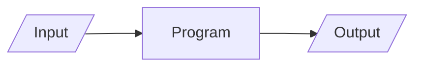
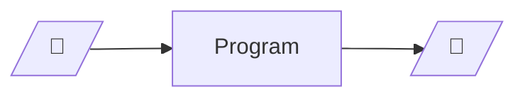
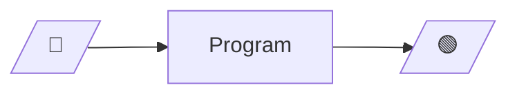
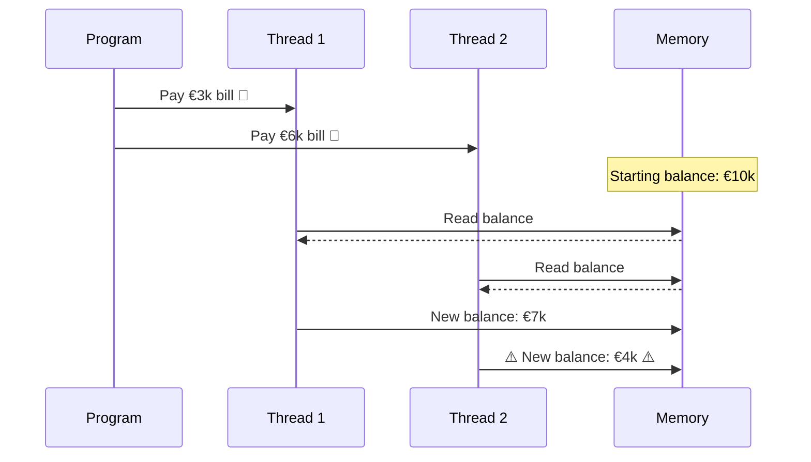

# Original problem

---
transition: fade
---

## What is a program

<div style="text-align: center" v-click>



</div>

<v-click><h2>What we want</h2></v-click>

<div style="text-align: center">
<div v-click>



</div>
<div v-click>



</div>
<div v-click>


</div>
</div>

---
transition: fade
---

## Stateful programs 1



---
transition: fade
---
## Stateful programs 2

```scala
class BankClient(var mainAccountId: Int, var customRate: Double, var leaningRate: Double) {
  def updateLeaningRate(/* arguments */) = {
    // some very complex logic
    leaningRate = // new value
    // other logic
  }
}
```

Want to change the above code ? You first need to

<v-clicks>

- Understand the whole class
- Understand the whole logic, beyond the method / class
- Think about edge cases (hard by definition)
- Write tests for your changes
- Write tests for those edge cases (usually requires lots of setup beforehand...)

</v-clicks>
